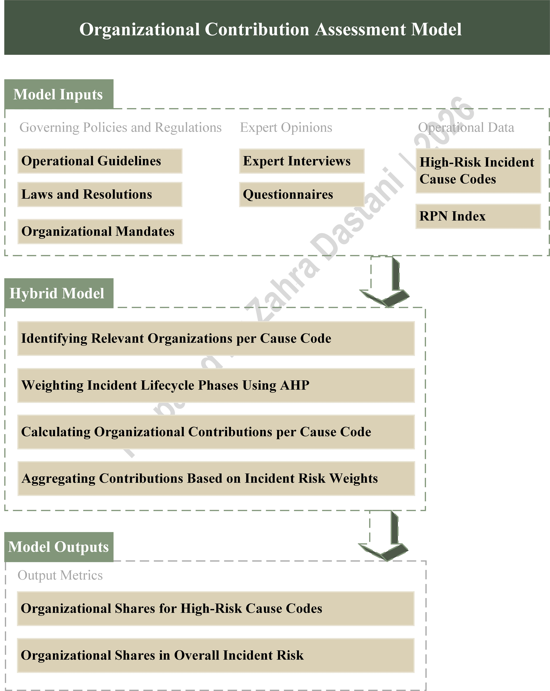

# Organizational Roles in Urban Incident Prevention, Response, and Oversight

**Client:** Mashhad Fire and Safety Services Organization  
**Role:** Project Manager & Lead Researcher  
**Domain:** Urban Incident Management  
**Approach:** Data Mining, Text Mining, Expert Interviews, and Multi-Criteria Decision Analysis

## Summary

This project investigated the roles and contributions of organizations and institutions in the occurrence, prevention, control, and oversight of urban incidents in Mashhad.

The study combined historical incident data analysis with expert-based assessments to identify incident causes, evaluate institutional responsibilities, and examine the extent of organizational involvement across different stages of incident management.

The overall objective was to provide an evidence-based understanding of institutional roles, identify gaps in organizational responsibilities and inter-agency coordination, and develop actionable insights to improve urban incident management.

## Objectives

- Analyze historical urban incident records to identify major causes, recurring patterns, and underlying factors.
- Identify and prioritize incident causes using quantitative analytical techniques.
- Examine the roles and responsibilities of relevant organizations and institutions.
- Evaluate organizational contributions across pre-incident, during-incident, and post-incident phases.
- Identify gaps in institutional responsibilities, oversight, and inter-agency coordination.
- Provide evidence-based recommendations to improve organizational performance in urban incident management.

## Data & Methodology

The research combined quantitative analysis of historical incident records with qualitative and expert-based assessments.

- **Historical Data Analysis:** Examined historical incident records to identify incident characteristics, causes, and recurring patterns.
- **Data Mining:** Applied analytical techniques to identify patterns and relationships in incident data.
- **Text Mining:** Analyzed incident descriptions to extract underlying information and identify recurring factors.
- **Risk Prioritization:** Applied a Risk Priority Number (RPN)-based approach to prioritize incident causes based on severity and frequency.
- **Expert Assessment:** Conducted structured expert interviews to evaluate institutional responsibilities and organizational contributions.
- **Multi-Criteria Decision Analysis:** Applied the Analytic Hierarchy Process (AHP) to determine the relative importance of different incident management phases.

## Organizational Assessment Framework

Organizational roles and contributions were evaluated across three interconnected phases of urban incident management:

- **Pre-Incident:** Prevention, preparedness, risk reduction, and monitoring.
- **During-Incident:** Emergency response, operational coordination, incident control, and support.
- **Post-Incident:** Recovery, follow-up, investigation, and post-incident oversight.

The assessment framework was used to examine the responsibilities and contributions of relevant organizations, compare their levels of involvement, and identify potential gaps in institutional coverage and coordination.

## Key Findings

- **Incident Cause Analysis:** Identified and prioritized major incident causes through quantitative analysis of historical records.
- **Organizational Role Mapping:** Mapped the responsibilities and contributions of relevant organizations across the three incident management phases.
- **Organizational Prioritization:** Evaluated and compared organizational involvement based on expert assessments and the developed evaluation framework.
- **Responsibility Coverage:** Examined the extent to which identified organizational responsibilities were covered by relevant institutions.
- **Structural Gap Analysis:** Identified gaps in institutional responsibilities and opportunities to strengthen inter-agency coordination.

## Conceptual Framework

The following diagram illustrates the overall research framework, including the historical incident data analysis, expert-based organizational assessment, and evaluation of institutional roles across the three phases of urban incident management.

## My Role

As the Project Manager and Lead Researcher, my responsibilities included:

- Managing the overall research process and coordinating project activities.
- Designing the analytical framework and research methodology.
- Conducting and supervising historical incident data analysis using data mining and text mining techniques.
- Developing the organizational assessment framework.
- Coordinating expert interviews and the evaluation of institutional responsibilities.
- Analyzing organizational contributions, responsibility coverage, and structural gaps.
- Developing research findings and actionable recommendations for improving urban incident management.

## Data Confidentiality

Due to data confidentiality and organizational considerations, raw incident records, detailed datasets, and sensitive analytical outputs are not publicly available. This repository presents the research framework, methodology, and a summary of the project's analytical approach and findings.

## Keywords

Urban Incident Management, Fire and Safety Services, Organizational Assessment, Data Mining, Text Mining, Risk Prioritization, RPN, Analytic Hierarchy Process (AHP), Expert Interviews, Institutional Coordination, Emergency Management
